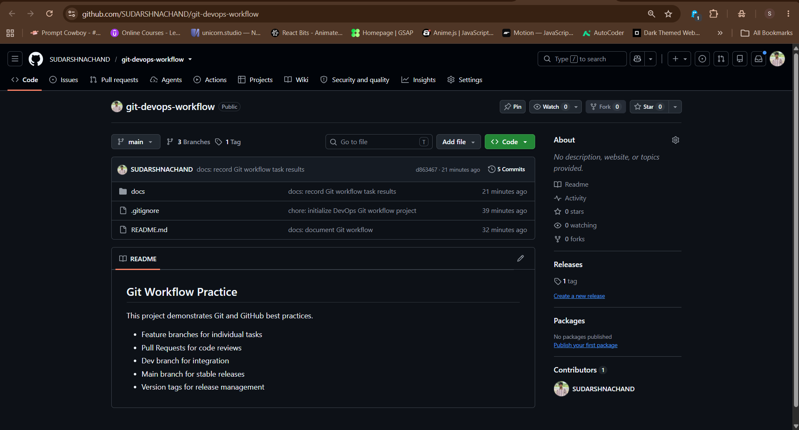
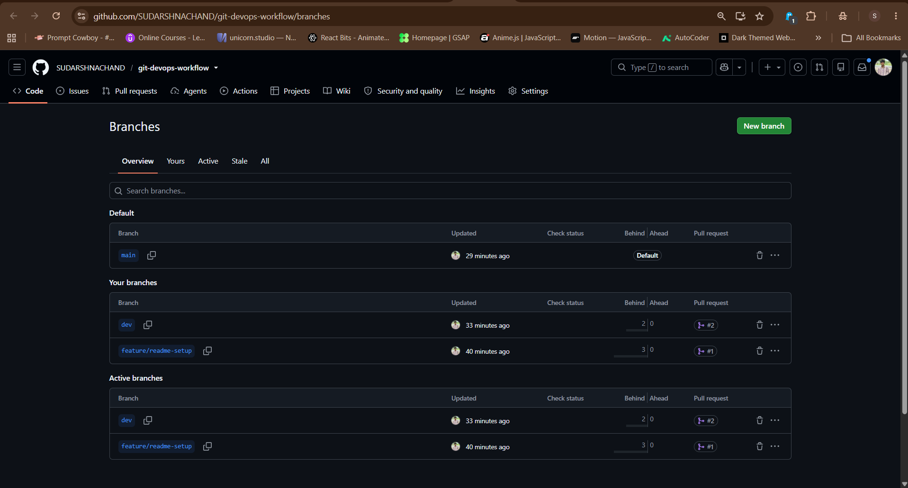
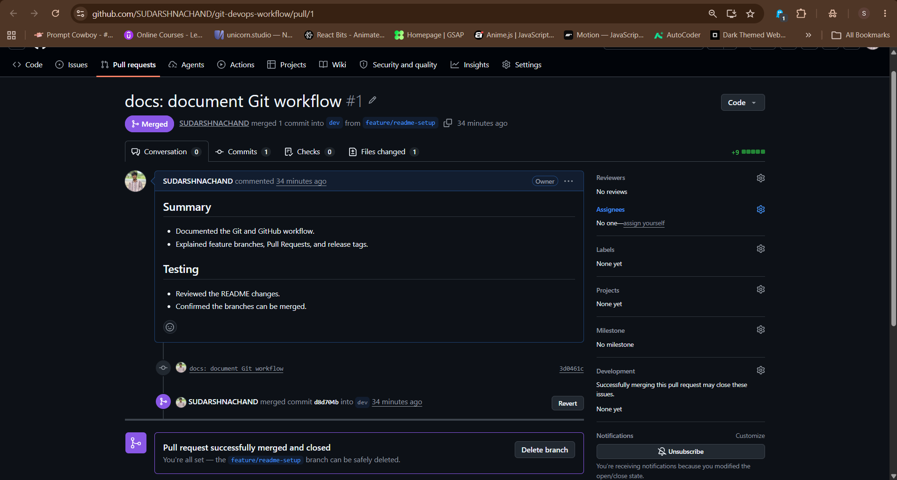
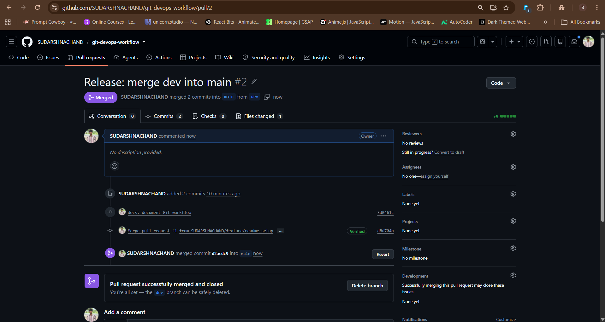
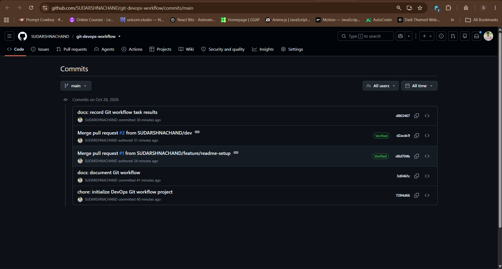
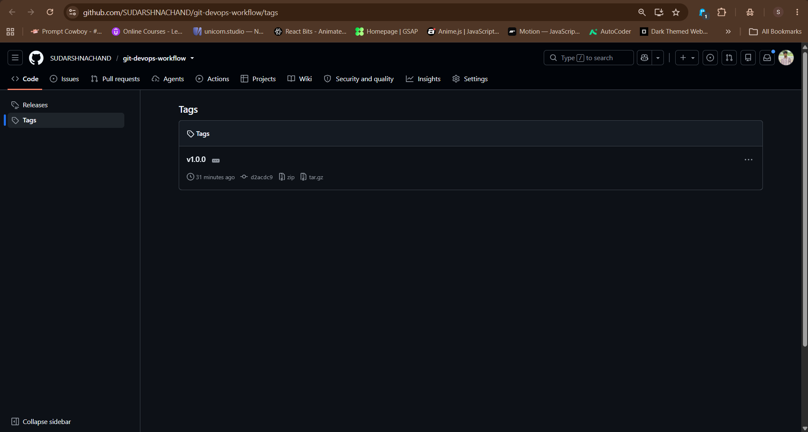
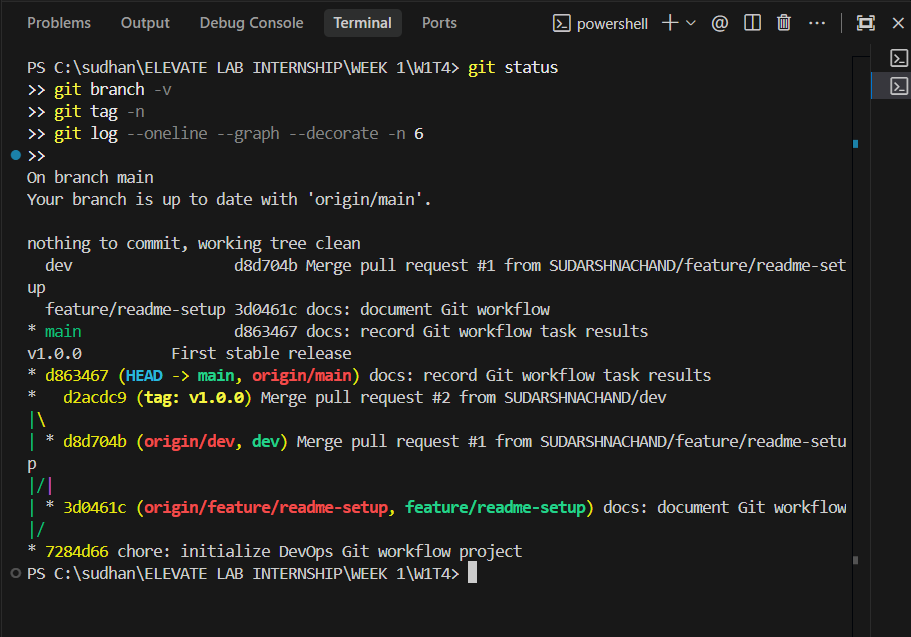

## Git Workflow Practice

This project demonstrates Git and GitHub best practices.

- Feature branches for individual tasks
- Pull Requests for code reviews
- Dev branch for integration
- Main branch for stable releases
- Version tags for release management

---

## Workflow Verification Screenshots

### 1. Repository Files & README
Repository root displaying structure, branch information, and rendered documentation.

---

### 2. Branch Structure
Branch overview showing `main` (default), `dev`, and `feature/readme-setup`.

---

### 3. Merged Pull Requests

#### Pull Request #1: `feature/readme-setup` → `dev`
Pull request successfully merged and closed into the development branch.

#### Pull Request #2: `dev` → `main`
Release pull request successfully merged and closed into the main branch.

---

### 4. Git Commit History
Commit log on GitHub showing the complete history and verified pull request merges.

---

### 5. Version Release Tag (`v1.0.0`)
Release tag created for the first stable release.

---

### 6. Terminal Verification
Successful local terminal verification showing clean status, branch tracking, release tag, and commit graph.

